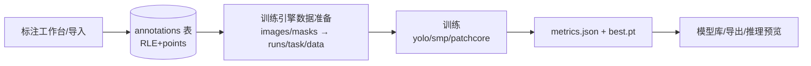

# 后端（FastAPI）开发指南

Python 3.11 · FastAPI · SQLite（标准库 sqlite3，零额外驱动）· 训练引擎以独立子进程运行。

## 目录结构

```
backend/
├── app/
│   ├── main.py          # 应用入口：CORS、路由自动发现、SPA 静态托管（/assets + history 回退）
│   ├── config.py        # 路径配置：CCD_BACKEND_DIR / CCD_RESOURCE_DIR / CCD_WEBUI_DIR 环境变量覆盖
│   ├── db.py            # SQLite SCHEMA + 增量迁移（_migrate 幂等）+ 常用索引 + busy_timeout
│   ├── routers/         # API 路由（统一前缀 /api）
│   ├── engines/         # 训练引擎 + 数据工具
│   ├── services/        # 训练任务队列（单 GPU 串行）
│   ├── xal/             # X-AnyLabeling 移植几何算法（椭圆/多边形光栅）
│   ├── ops.py           # 预处理/增强算子注册表（albumentations 2.0.8 适配）
│   └── scenes_data.py   # 场景方案内置数据
├── pack/                # 打包（见 pack/README.md）
├── tests/               # pytest（隔离临时库）
└── data/                # 运行时：ccd.db + runs/{task_id}/
```

## 核心数据流



- **标注存储**：mask 标注 `data` = `{points, rle}`——`rle` 为权威像素数据（Label Studio/COCO 兼容
  Fortran 列优先格式），`points` 为简化轮廓（渲染/兼容）。详见 `engines/rle.py`。
- **训练任务**：`POST /api/train` 写入 config.json → `services/train_queue.py` 排队 →
  独立子进程运行引擎（源码 `python -m` / 冻结版 `--engine-runner`）→ 成功回写 metrics。
- **评估输出**：`runs/{task_id}/` 下 `results.csv`（每 epoch）、`metrics.json`、`viz/`（PR 曲线、预测图）。

## API 路由一览

| 前缀 | 模块 | 主要端点 |
|---|---|---|
| `/api/projects` | projects.py | 项目 CRUD、数据集类别（含「正常」常驻类别） |
| `/api/datasets` | datasets.py | 数据集创建/扫描导入、图像分页、划分、增强扩充 |
| `/api/images/{id}/annotations` | annotations.py | 标注 CRUD、**导入（`/import-folder` 傻瓜式自动识别 YOLO/LabelMe/COCO）** |
| `/api/annotations/...` | annotations.py + sam.py | 笔刷（creates RLE）、逐像素 paint（进程内互斥锁）、SAM 预测 |
| `/api/preview` | preprocess.py | 预处理/增强预览、模型视角 letterbox 预览 |
| `/api/pipelines` | preprocess.py | 预处理/增强管线 CRUD |
| `/api/train` · `/api/tasks` | train.py | 训练提交/列表/日志/停止 |
| `/api/models` | models.py | 模型库、导入（torch 权重仅 weights_only 安全加载） |
| `/api/prediction` · `/api/export` | prediction.py / export.py | 推理预览、ONNX/torch 导出 |
| `/api/cluster` · `/api/curves` · `/api/dashboard` | 各自模块 | 聚类、训练曲线、首页看板 |

## 训练引擎

引擎继承 `engines/base.py::EngineBase`（模板方法 `start()`：running → run() → 产物校验 → success/failed）。
新增引擎三步：实现 `run()`（设置 `self.weights_path` 等）→ `train_queue.ENGINE_REGISTRY` 注册 →
前端经 `/api/engines` 自动出表单。详见 [ENGINES.md](../ENGINES.md)。

内置引擎：`yolo_detect`（检测）、`yolo_classify`（分类）、`smp_segment`（分割）、`anomaly`（PatchCore 异常检测）。

## 关键设计约定

- **设备**：一律经 `engines/data_utils.py::resolve_device(cfg)`（cfg.device 优先 → CUDA 自动检测 → CPU），
  禁止硬编码 `device=0`。
- **路径**：RUNS_DIR/DB_PATH 统一来自 `config.py`，禁止在路由内自行推导。
- **RLE 消费**：训练数据准备/增广/统计统一经 `engines/rle.py::ann_to_mask`（rle 优先，points 兜底）。
- **测试**：`tests/conftest.py` 在 import app 前设 `CCD_BACKEND_DIR` 到临时目录——测试**绝不触碰生产库**。

## 开发命令

```bat
:: 启动（开发）
.venv\Scripts\python -m uvicorn app.main:app --host 127.0.0.1 --port 8000

:: 测试
.venv\Scripts\python -m pytest tests -q

:: 单测 RLE 编解码要点：Fortran 列优先往返、空/全掩码边界、cv2 连续性（numpy 2.x 需 ascontiguousarray）
```
